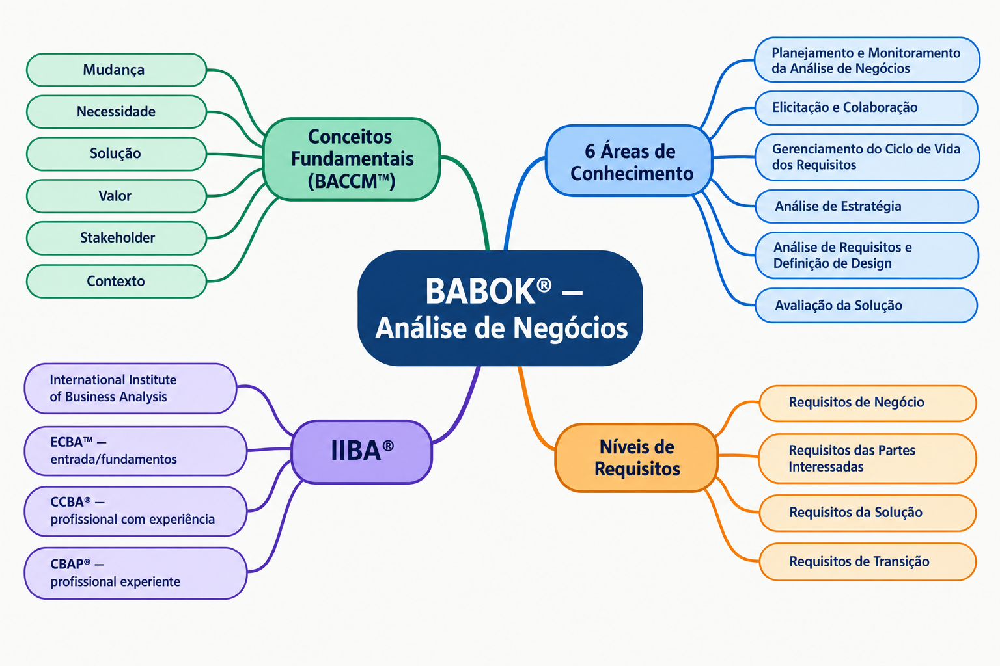

# Unidade 2 – Análise de Negócio (BABOK®)

## Atividade: Mapa Mental do BABOK®

**Objetivo:** Mapear os conceitos fundamentais e as áreas de conhecimento da Análise de Negócio segundo o BABOK® Guide (IIBA).

O mapa mental acima foi gerado com apoio de ferramenta de IA (ChatGPT), a partir de anotações de aula, com os termos corrigidos e validados conforme a terminologia oficial do BABOK®. Ele cobre:

- **Conceitos Fundamentais (BACCM™):** Mudança, Necessidade, Solução, Valor, Stakeholder, Contexto
- **6 Áreas de Conhecimento:** Planejamento e Monitoramento da Análise de Negócios; Elicitação e Colaboração; Gerenciamento do Ciclo de Vida dos Requisitos; Análise de Estratégia; Análise de Requisitos e Definição de Design; Avaliação da Solução
- **Níveis de Requisitos:** Requisitos de Negócio, das Partes Interessadas, da Solução e de Transição
- **IIBA®:** o que é e as certificações ECBA™, CCBA® e CBAP®

## Fontes de Pesquisa

- IIBA — A Guide to the Business Analysis Body of Knowledge (BABOK® Guide). Disponível em: https://www.iiba.org/career-resources/a-business-analysis-professionals-foundation-for-success/babok/. Acesso em: 13 set. 2026.
- IIBA — Global Business Analysis Standards, Regulations and Best Practices. Disponível em: https://www.iiba.org/career-resources/a-business-analysis-professionals-foundation-for-success/global-business-analysis-standards-regulations-and-best-practices/. Acesso em: 13 set. 2026.
- IIBA — Business Analysis Certifications. Disponível em: https://www.iiba.org/business-analysis-certifications/iiba-certifications/. Acesso em: 13 set. 2026.
- INTERNATIONAL INSTITUTE OF BUSINESS ANALYSIS (IIBA). BABOK® Guide Appendix A: Glossary. Disponível em: https://www.iiba.org/career-resources/a-business-analysis-professionals-foundation-for-success/babok/glossary/. Acesso em: 10 ago. 2026.
